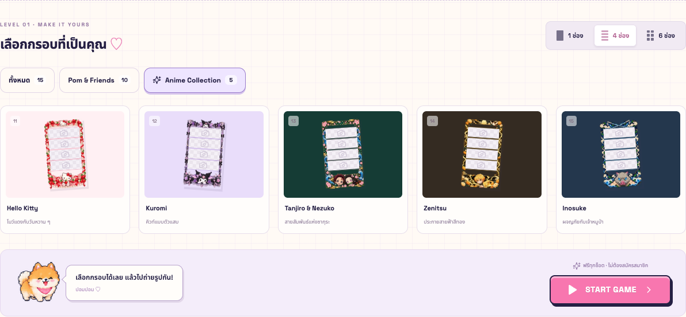

# Pomeranian Photo Booth Arcade

เว็บถ่ายรูปสไตล์ Kawaii Pixel Arcade ใช้งานบน localhost ครบ 5 ขั้นตอน: เลือกกรอบ → ถ่ายรูป → ตกแต่ง → Preview → ดาวน์โหลด PNG

เว็บออนไลน์: **https://photo-booth-arcade.vercel.app**



## เริ่มใช้งาน

ต้องมี Node.js 20.9+ (พัฒนาบน 24.20.0) และ pnpm 10

```sh
pnpm install
pnpm dev
```

เปิด **http://localhost:3000** แล้วเลือกกรอบ/จำนวนช่อง กด **START GAME** และอนุญาตใช้กล้อง หรืออัปโหลด JPG, PNG, WebP แทนได้

Production:

```sh
pnpm build
pnpm start
```

ไฟล์ Artwork ที่พร้อมใช้รวมอยู่ในโปรเจกต์แล้ว ไม่ต้องมี API key หรือเรียกสร้างภาพใหม่ตอนรันแอป

## Deploy บน Vercel

โปรเจกต์ Vercel ชื่อ `photo-booth-arcade` เชื่อมกับ GitHub repository นี้ ใช้ Next.js preset, Node.js 24.x และ pnpm 10.32.1 ไม่ต้องตั้ง environment variables สำหรับการทำงานของแอป

```sh
pnpm dlx vercel@latest login
pnpm dlx vercel@latest link --project photo-booth-arcade --scope vittayaions-projects
pnpm dlx vercel@latest deploy --prod --scope vittayaions-projects
```

`.vercelignore` ไม่ส่งภาพต้นฉบับและไฟล์ QA ขึ้นชุด deploy แต่ส่ง Production Assets ใน `public/assets` ครบ ส่วน `.vercel` และ `.env*` ถูก ignore จาก Git กล้องทำงานผ่าน HTTPS โดยยังต้องได้รับสิทธิ์จากผู้ใช้

## สิ่งที่ใช้งานได้

- กรอบ 15 ธีม × 3 Layout: 1 ภาพใหญ่, 4 ภาพเรียงแนวตั้ง, 6 ภาพแบบ 2 × 3
- Anime Collection อีก 5 แบบ: Hello Kitty, Kuromi, Tanjiro & Nezuko, Zenitsu และ Inosuke พร้อมตัวกรองคอลเลกชัน
- กด CAPTURE ครั้งเดียว ถ่ายช่องว่างต่อเนื่อง พร้อม Countdown 3 วินาทีต่อภาพ, Cancel, สลับกล้อง และ Retake เฉพาะช่อง
- เลือกช่องเพื่อแทนที่ภาพ หรือ Upload หลายภาพเติมช่องว่าง ผสมภาพจากกล้องและ Upload ได้
- เอฟเฟกต์ 7 แบบใช้ได้ทั้งกล้องและ Upload และถูกบันทึกลงภาพจริง
- Sticker Editor: แตะ/ลากสติกเกอร์, ลากจาก palette, ย่อขยาย, หมุน, ลบ, ทำซ้ำ, Undo/Redo 100 ขั้น, ข้อความไทย/อังกฤษพร้อมสีและขนาด
- Keyboard: ⌘/Ctrl+Z, ⌘/Ctrl+Shift+Z, Ctrl+Y, Delete/Backspace (ไม่รบกวนการพิมพ์ข้อความ)
- หมาปอม 9 animation states พร้อม Speech Bubble ไทย, ฉาก Home 4 แบบ และ printer animation
- PNG 1024 × 1820 ที่รวมภาพ กรอบ สติกเกอร์ และข้อความ ไม่รวม selection/controls
- Mouse/touch, responsive mobile และ reduced motion

## โครงสร้าง

```text
src/app/                       5 routes และ global styles
src/components/                ArcadeButton, header, stepper และ UI ร่วม
src/features/frames/           catalog, frame selector และ strip preview
src/features/camera/           MediaDevices, capture/upload และ effect compositing
src/features/editor/           Zustand document/history และ react-konva composition
src/features/mascot/           sprite player ที่อ่าน animation metadata
src/features/export/           preview, printer และ download
public/assets/                 Production PNG/WebP/SVG และ JSON manifests
artwork/source/                21 ภาพต้นฉบับที่สร้างด้วย Image Generation
artwork/generated-svg/         ต้นฉบับ vector ของสติกเกอร์และข้อความ
artwork/qa/                    ภาพหน้าจอจาก browser tests
scripts/                       asset builder และตัวตรวจ alpha/dimensions
tests/                         Playwright end-to-end tests
```

## Artwork และการเพิ่มกรอบ

ใช้ built-in Image Generation สร้างมาสคอตหลัก, sprite sheet 36 เฟรม, กรอบต้นฉบับ 15 ธีม และฉาก 4 แบบ ภาพ Reference ใช้เป็นแนวทางการออกแบบเท่านั้น ไม่ได้ใช้ทั้งภาพเป็น Production Asset

Sharp แยกตัวละครโดยค้นหา connected components ของ alpha เพื่อไม่ตัดหู/หาง สร้างแผ่น sprite 512 × 128 และเว้นขอบโปร่งใสให้เฟรม 128 × 128 สติกเกอร์ปอม 4 ชิ้นมาจาก sprite ส่วนสติกเกอร์ตกแต่ง 28 ชิ้น, ข้อความ 9 แบบ, เอฟเฟกต์ และ UI วาดเป็น SVG แล้ว rasterize ตามการใช้งาน ดูชุด prompt ใน `artwork/PROMPTS.md`

กรอบ Production เป็น PNG 45 ไฟล์พร้อมช่องโปร่งใสจริง และมี WebP thumbnails 45 ไฟล์เพื่อให้หน้าเลือกกรอบโหลดเบา ช่องภาพใช้ `slotsFor()` ใน `src/features/frames/catalog.ts` เป็นแหล่งข้อมูลเดียวสำหรับ mask และ renderer

กรอบ Anime ใช้พื้นที่ภาพ `(96, 220, 832, 1116)` เพื่อเว้นตัวละครในส่วนหัวและท้ายกรอบครบ ไม่ถูก mask ตัด ส่วนกรอบเดิมใช้พิกัดเดิม ทั้งสองชุดรองรับ 1/4/6 ช่องและอ่านตำแหน่งจาก Manifest เดียวกัน

เพิ่มกรอบใหม่:

1. เพิ่มต้นฉบับ `artwork/source/frame-<id>.png` เป็น Artwork ขอบภาพแนวตั้ง
2. เพิ่มชื่อ สี และ ID ใน `definitions` ของ catalog
3. รันคำสั่งด้านล่าง จะสร้างทั้ง 3 Layout, thumbnails และ `public/assets/manifest.json`

```sh
pnpm assets:build
pnpm assets:check
```

ตัว builder ใช้ต้นฉบับที่จัดเก็บไว้แล้ว จึงทำซ้ำได้โดยไม่เรียก AI API ช่องภาพทุกพิกเซลต้องมี alpha=0; checkerboard ในหน้าเลือกกรอบวาดด้วย CSS และไม่ได้ฝังใน PNG

## Rendering และความเป็นส่วนตัว

Editor เก็บตำแหน่งทั้งหมดในพิกัด 1024 × 1820 และย่อ Stage ตามจอ Export clone เฉพาะ scene เดิมที่ scale=1 ลบชั้น `editor-controls` แล้วเรียก Canvas `toBlob('image/png')` เมื่อภาพและฟอนต์พร้อม Preview, Result และ Download ใช้ PNG Blob เดียวกัน

ฟอนต์และ Artwork โหลดจากโปรเจกต์ ภาพถ่าย/Upload อยู่ใน memory และ Blob URLs ของ browser ไม่มี photo upload endpoint, database หรือบริการประมวลผลภาพภายนอก Camera tracks ถูกหยุดเมื่อออกจากหน้า และคืน Blob URLs เมื่อแทนที่ภาพ/เริ่มใหม่ ประวัติแก้ไขอยู่เฉพาะ session; รีเฟรชหรือปิดหน้าแล้วงานจะหาย

## ตรวจสอบ

```sh
pnpm typecheck
pnpm assets:check
pnpm build
pnpm test
```

Playwright เปิด production server ชั่วคราวที่ port 3100 แยกจาก dev server บน port 3000 และไม่ reuse server ที่เปิดอยู่ ใช้ Google Chrome ที่ติดตั้งไว้ (`channel: 'chrome'`) พร้อมกล้องจำลอง จึงไม่เปิดกล้องจริงขณะทดสอบ หากไม่มี Chrome ให้ติดตั้ง Chrome หรือเปลี่ยน channel แล้วติดตั้ง Chromium ของ Playwright

การทดสอบครอบคลุม Assets/alpha, camera 1/4/6 ช่อง, cancellation, retake, permission denied, Upload เสีย, mouse/touch gestures, Undo/Redo, text editing, route guards, PNG dimensions/pixels และความตรงกันของ Preview/Download พร้อม screenshots ที่ 375/768/1440 px ดูผลล่าสุดใน `TESTING.md`

## ข้อจำกัดที่ทราบ

- ทดสอบกล้องด้วย stream จำลอง การอนุญาตกล้องจริงขึ้นกับ browser/OS และยังต้องตรวจบนอุปกรณ์จริง
- Chrome desktop และ mobile emulation เป็นสภาพแวดล้อม QA; ยังไม่ได้ตรวจ Safari/iOS/Android จริง
- กล้องบน `http://localhost` ใช้ได้ แต่เปิดจากโทรศัพท์ผ่าน LAN IP แบบ HTTP จะต้องใช้ HTTPS เพื่อให้ browser อนุญาต MediaDevices
- Upload รองรับ JPEG/PNG/WebP; HEIC ต้องแปลงก่อน ไม่มีระบบบันทึกงานข้ามการรีเฟรช
- คุณภาพภาพถ่ายขึ้นกับความละเอียดกล้อง/รูปต้นฉบับ และภาพถูก crop กลางให้พอดีกับช่องที่เลือก
